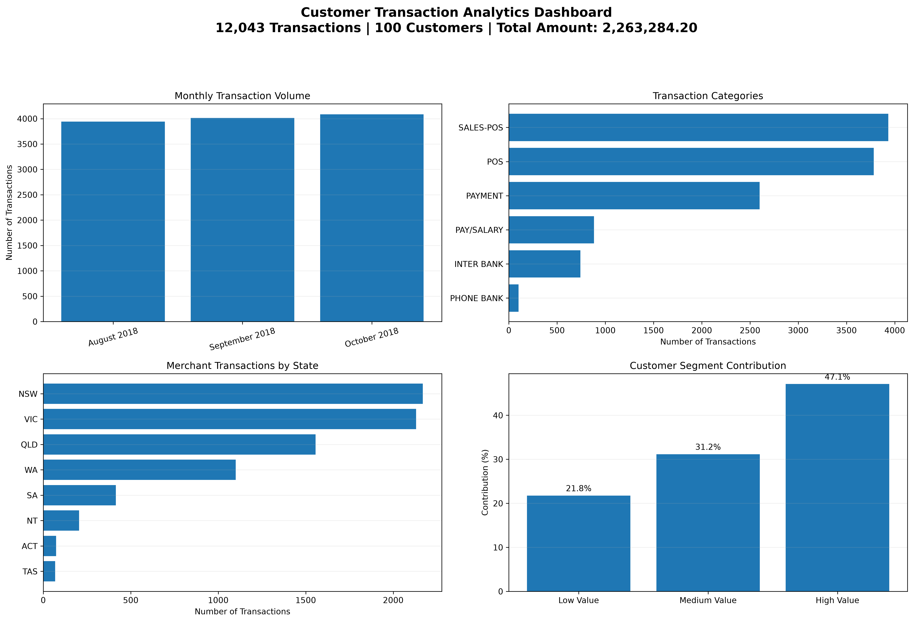

# Customer Transaction Prediction and Analysis

A data science project focused on analysing customer payment transactions, understanding financial behaviour, identifying transaction patterns, and developing machine learning models for transaction classification.

## Project Overview

This project applies Python and data science techniques to a payment transaction dataset containing 12,043 transaction records from 100 customers over a three-month period (August–October 2018).

The project follows an end-to-end data science workflow, covering data collection, data cleaning, exploratory data analysis, statistical analysis, machine learning, text analysis, and business-oriented visualisation.

The primary objective is to transform raw transaction data into meaningful insights and explore how machine learning can support transaction analysis and classification.

## Project Objectives

- Collect, inspect, and preprocess transaction data.
- Identify missing values, duplicates, inconsistencies, and potential outliers.
- Perform Exploratory Data Analysis (EDA) to understand transaction patterns.
- Analyse customer-level transaction frequency and financial activity.
- Investigate relationships between transaction attributes.
- Develop machine learning models to classify debit and credit transactions.
- Evaluate model performance using appropriate classification metrics.
- Analyse transaction descriptions and merchant-related information.
- Present analytical findings through visualisations and a consolidated dashboard.

## Dataset Description

The project uses a payment transaction dataset containing:

| Attribute | Description |
|---|---|
| Transaction records | 12,043 |
| Unique customers | 100 |
| Processed dataset attributes | 24 |
| Time period | August–October 2018 |
| Target variable | Movement (Debit/Credit) |

The dataset contains information relating to:

- Transaction amount and account balance.
- Customer demographics.
- Transaction descriptions and categories.
- Transaction dates and timestamps.
- Merchant information and geographical details.
- Debit and credit movement.

**Dataset availability:** The original and processed datasets are excluded from this repository. Users must obtain the dataset separately and place it in the appropriate project directory before executing the notebooks.

## Technologies Used

| Category | Technologies |
|---|---|
| Programming Language | Python |
| Data Manipulation | Pandas, NumPy |
| Data Visualisation | Matplotlib, Seaborn |
| Machine Learning | Scikit-learn |
| Text Analysis | Python string processing, Pandas |
| Development Environment | Jupyter Notebook, VS Code |
| Version Control | Git, GitHub |

Additional packages such as NLTK, WordCloud, Plotly, and Streamlit are included in the dependency file for potential extensions. They should not be interpreted as completed project features.

## Project Workflow

The project is organised into five notebooks, each covering a specific stage of the data science lifecycle.

### 1. Data Collection and Cleaning

**Notebook:** `1_DataCollection_Cleaning.ipynb`

This stage prepares the raw transaction dataset for further analysis.

Key activities:

- Loaded and inspected the original transaction dataset.
- Examined dataset structure, attributes, and data types.
- Identified and handled missing values.
- Checked duplicate records and inconsistent values.
- Standardised relevant columns and categorical attributes.
- Processed transaction dates and numerical fields.
- Prepared and exported the cleaned dataset.

**Output:** `data/processed/cleaned_transactions.csv`

### 2. Exploratory Data Analysis (EDA)

**Notebook:** `2.EDA.ipynb`

This stage explores the dataset to identify patterns, distributions, and relationships between transaction attributes.

Key activities:

- Analysed debit and credit transaction distributions.
- Examined transaction amount distributions.
- Investigated monthly, daily, and time-based transaction activity.
- Studied customer transaction frequency.
- Compared transaction amounts across different transaction types.
- Analysed demographic attributes such as age and gender.
- Investigated account balance changes and potential inconsistencies.
- Examined correlations and statistical relationships.

**Output:** Exploratory analysis and supporting visualisations.

### 3. Transaction Classification

**Notebook:** `3.TransactionClassification.ipynb`

This stage develops machine learning models to classify transactions as debit or credit.

**Target variable:** `movement`

Models implemented:

- Dummy Classifier — baseline model.
- Logistic Regression — linear classification model.
- Random Forest Classifier — ensemble-based classification model.

Key activities:

- Examined target distribution and class imbalance.
- Investigated potential target leakage.
- Selected relevant numerical and categorical features.
- Applied preprocessing using StandardScaler and OneHotEncoder.
- Used customer-aware stratified splitting to evaluate generalisation to unseen customers.
- Evaluated models using accuracy, precision, recall, F1-score, balanced accuracy, and confusion matrices.
- Performed feature ablation and permutation importance analysis.
- Used stratified group cross-validation for additional evaluation.

**Model evaluation — held-out test set**

| Model | Accuracy | Credit Precision | Credit Recall | Credit F1 |
|---|---:|---:|---:|---:|
| Dummy Classifier | 92.92% | 0.00% | 0.00% | 0.00% |
| Logistic Regression | 98.85% | 86.07% | 100.00% | 92.51% |
| Random Forest | 99.18% | 95.27% | 93.06% | 94.15% |

Random Forest achieved the strongest overall held-out performance among the evaluated models.

**Important finding:** Transaction amount was the most influential feature in the classification models. Transaction descriptions and account balance were excluded because they could reveal the target directly or indirectly, creating target leakage.

### 4. Text Analysis

**Notebook:** `4.Text_Analysis.ipynb`

This stage investigates the categorical and text-based attributes associated with transactions.

Key activities:

- Identified text and object-type columns.
- Analysed transaction descriptions and their frequencies.
- Examined merchant suburb and state information.
- Standardised inconsistent merchant suburb names.
- Investigated relationships between transaction descriptions and debit/credit movements.
- Examined missing merchant location information.

**Important findings:**

- Six transaction description categories were identified.
- PAY/SALARY transactions were exclusively credit transactions.
- The remaining transaction description categories were exclusively debit transactions.
- Merchant suburb and state information was available only for POS and SALES-POS transactions.

The transaction descriptions behaved as fixed transaction labels rather than free-form natural language. Therefore, categorical text analysis was more appropriate than advanced NLP techniques for this dataset.

The relationship between transaction descriptions and movement also confirmed that transaction descriptions would cause target leakage if used as classification features.

### 5. Transaction Visualisation and Dashboard

**Notebook:** `5.Visualization_&Dashboard.ipynb`

This stage consolidates important findings from the previous analytical stages into business-oriented visualisations.

Key activities:

- Generated overall transaction KPIs.
- Compared debit and credit transaction distributions.
- Analysed transaction amount distributions.
- Compared debit and credit transaction amounts.
- Examined monthly transaction activity.
- Analysed transaction category distributions.
- Identified customers with high transaction frequency and transaction value.
- Investigated merchant transaction distribution across Australian states.
- Segmented customers according to total transaction value.
- Compared customer segment contributions.
- Created a consolidated business dashboard.

### Dashboard Preview



The dashboard summarises four important business perspectives:

1. Monthly transaction volume.
2. Transaction category distribution.
3. Merchant transaction distribution by state.
4. Customer segment contribution to total transaction value.

## Key Project Findings

### Transaction Activity

- The dataset contains 12,043 transactions across 100 customers.
- Total transaction amount is approximately 2.26 million (dataset currency not independently verified).
- Debit transactions account for 92.67% of all records.
- Credit transactions account for 7.33%.
- October recorded the highest monthly transaction volume and total transaction amount.

### Transaction Amount Analysis

- Transaction amounts exhibit a strongly right-skewed distribution.
- Most transactions have relatively small amounts.
- A comparatively small number of high-value transactions influence the overall average.
- Credit transactions have a substantially higher median amount than debit transactions.

### Customer Behaviour

- Customers with the highest transaction frequency are not necessarily those with the highest total transaction value.
- Customer segmentation identified Low Value, Medium Value, and High Value groups using relative transaction-value rankings.
- High Value customers contributed approximately 47.09% of total transaction value.

### Geographic Analysis

- New South Wales recorded the highest number of merchant-state transactions.
- Victoria ranked second, followed by Queensland and Western Australia.
- The four leading states accounted for approximately 90.13% of records containing merchant-state information.

**Limitation:** Merchant-state information was available for only 7,717 transactions, primarily POS and SALES-POS records. Geographic findings therefore should not be generalised to every transaction in the dataset.

## Machine Learning Evaluation and Limitations

The classification models demonstrated strong performance on the available data. However, the results should be interpreted in the context of the dataset.

- The dataset contains only 100 unique customers.
- The observation period covers only three months.
- Transaction amount is a highly influential predictor.
- Customer-aware evaluation helps assess generalisation to customers not included in training.
- Group cross-validation results and held-out test results represent different evaluation procedures.
- The current evaluation does not establish how well the models predict future transactions over time.
- The models classify debit and credit movements; they do not independently establish fraudulent or anomalous transactions.

Further validation using larger datasets and longer observation periods would be necessary before considering real-world deployment.

## Project Structure

```text
customer-transaction-analytics/
│
├── data/
│   ├── raw/                         # Original dataset (not uploaded)
│   └── processed/                   # Cleaned dataset (not uploaded)
│
├── notebooks/
│   ├── 1_DataCollection_Cleaning.ipynb
│   ├── 2.EDA.ipynb
│   ├── 3.TransactionClassification.ipynb
│   ├── 4.Text_Analysis.ipynb
│   └── 5.Visualization_&Dashboard.ipynb
│
├── src/                             # Supporting Python modules
│
├── dashboard/
│   └── customer_transaction_dashboard.png
│
├── images/                          # Individual project visualisations
│
├── requirements.txt
├── requirements-lock.txt
├── .gitignore
└── README.md
```

## Installation and Setup

### 1. Clone the repository

```bash
git clone https://github.com/lakshmsh/customer-transaction-analytics.git
```

### 2. Navigate to the project directory

```bash
cd customer-transaction-analytics
```

### 3. Create a virtual environment

```bash
python -m venv venv
```

### 4. Activate the virtual environment

For Windows PowerShell:

```powershell
.\venv\Scripts\Activate.ps1
```

### 5. Install dependencies

```bash
python -m pip install -r requirements.txt
```

### 6. Add the dataset

Place the required raw dataset at:

```text
data/raw/payment_transactions.csv
```

The dataset is not distributed with this repository.

### 7. Run the notebooks

Open the project in VS Code or Jupyter Notebook.

Execute the notebooks in the following order:

1. Data Collection and Cleaning
2. Exploratory Data Analysis
3. Transaction Classification
4. Text Analysis
5. Visualisation and Dashboard

Ensure the cleaned dataset is generated before executing the subsequent notebooks.

## Current Project Status

| Component | Status |
|---|---|
| Project setup and environment | Completed |
| Data collection and cleaning | Completed |
| Exploratory Data Analysis | Completed |
| Statistical analysis and visualisation | Completed |
| Transaction classification | Completed |
| Model evaluation and feature analysis | Completed |
| Text and categorical analysis | Completed |
| Customer segmentation | Completed |
| Consolidated static dashboard | Completed |
| Interactive dashboard deployment | Planned |
| Advanced anomaly detection | Planned |

## Future Scope

- Explore anomaly detection techniques to identify unusual transaction behaviour.
- Investigate additional classification algorithms and feature engineering approaches.
- Evaluate models using larger datasets and time-based validation.
- Develop an interactive dashboard using Streamlit and Plotly.
- Explore customer behavioural patterns over longer periods.
- Improve model explainability and interpretation.
- Investigate real-world deployment and automated analytical reporting.

---

**Project Note:** This project was developed as a practical application of Python programming, data analysis, statistical methods, visualisation, and machine learning. The findings and model performance reflect the available dataset and its limitations.