# Customer Transaction Prediction and Analysis

## Project Overview

This project focuses on analysing customer payment transactions to understand transaction patterns, customer behaviour, and financial activity.

Using Python and data science techniques, the project explores transaction trends, customer-level spending behaviour, transaction distributions, and relationships between different transaction attributes.

The project follows a structured data science workflow involving data collection, data cleaning, exploratory data analysis (EDA), data visualisation, and the development of predictive and analytical models.

The long-term objective is to extract meaningful insights from transaction data and explore techniques for identifying unusual transaction behaviour.

## Project Objectives

- Collect and prepare transaction data for analysis.
- Perform data cleaning and preprocessing.
- Conduct Exploratory Data Analysis (EDA) to identify patterns and relationships.
- Analyse customer-level debit and credit behaviour.
- Identify transaction trends and potential anomalies.
- Visualise important findings through charts and interactive dashboards.
- Explore suitable machine learning techniques for predictive analysis.
- Evaluate model performance using appropriate evaluation metrics.

## Dataset Description

The project uses a payment transaction dataset containing:

- **12,043 transaction records**
- **100 unique customers**
- **23 original attributes**
- Transaction records spanning August to October 2018.

The dataset includes information such as transaction amount, customer details, transaction descriptions, account balance, merchant information, transaction dates, and debit/credit movements.

**Note:** The original and processed datasets are excluded from this repository to protect customer and financial information.

## Technologies Used

| Category | Technologies |
|---|---|
| Programming Language | Python |
| Data Manipulation | Pandas, NumPy |
| Data Visualisation | Matplotlib, Seaborn, Plotly |
| Machine Learning | Scikit-learn |
| Text Analysis | NLTK, WordCloud |
| Interactive Dashboard | Streamlit |
| Development Environment | Jupyter Notebook, VS Code |
| Version Control | Git, GitHub |

Some technologies are intended for upcoming project stages and may not yet be implemented.

## Project Workflow

### 1. Data Collection and Cleaning

- Loaded the transaction dataset using Pandas.
- Inspected dataset structure, columns, and data types.
- Identified missing values and duplicate records.
- Standardised column names and categorical values.
- Corrected inconsistent date formats.
- Validated and saved the cleaned dataset.

### 2. Exploratory Data Analysis (EDA)

- Analysed transaction types and amounts.
- Compared debit and credit transactions.
- Examined monthly and daily transaction trends.
- Studied customer-level transaction frequency and behaviour.
- Analysed transaction amounts across different categories.
- Investigated account balance changes.
- Examined missing-value patterns and potential outliers.
- Explored relationships between numerical variables.

### 3. Upcoming Development

- Transaction classification and predictive modelling.
- Text analysis of transaction-related information.
- Advanced visualisation and interactive dashboard development.
- Customer-level anomaly detection and behavioural analysis.

## Exploratory Data Analysis — Visual Results

The following visualisations represent the findings generated during the EDA stage.

### Transaction Analysis

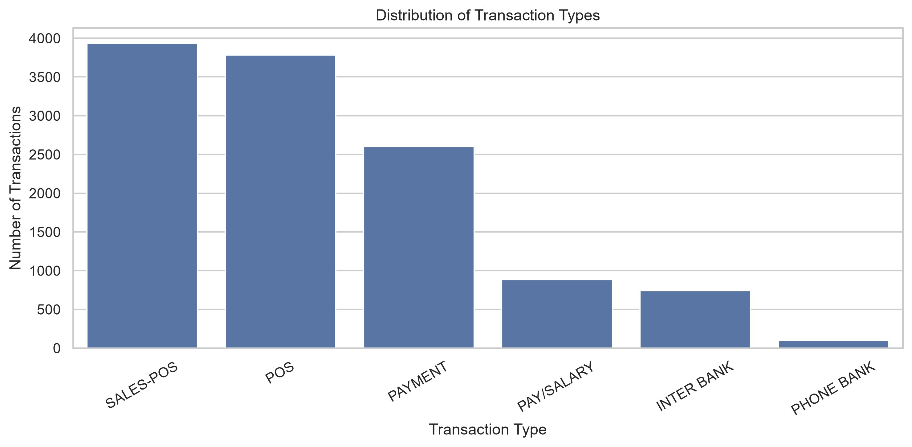

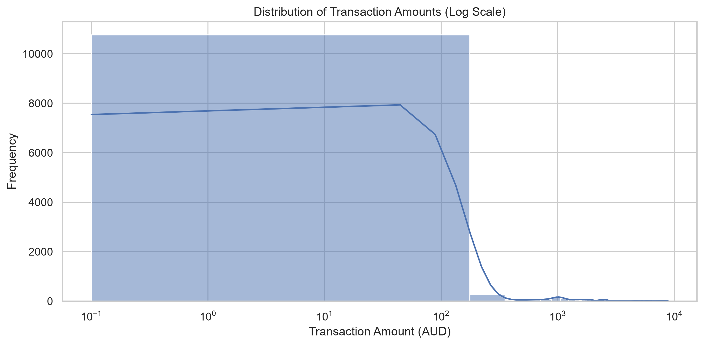

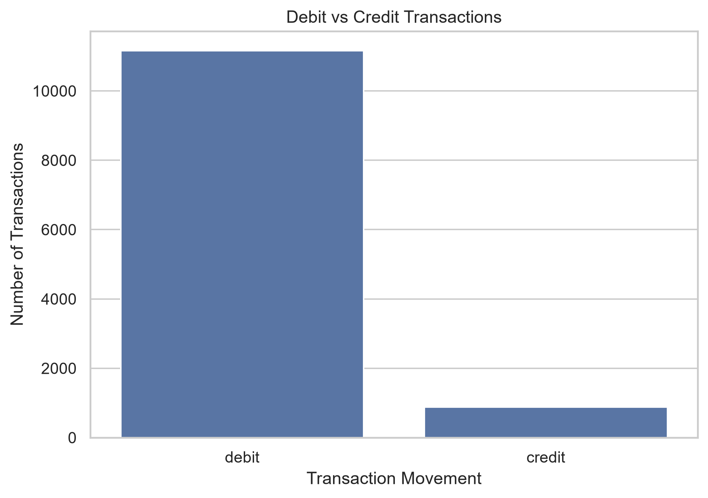

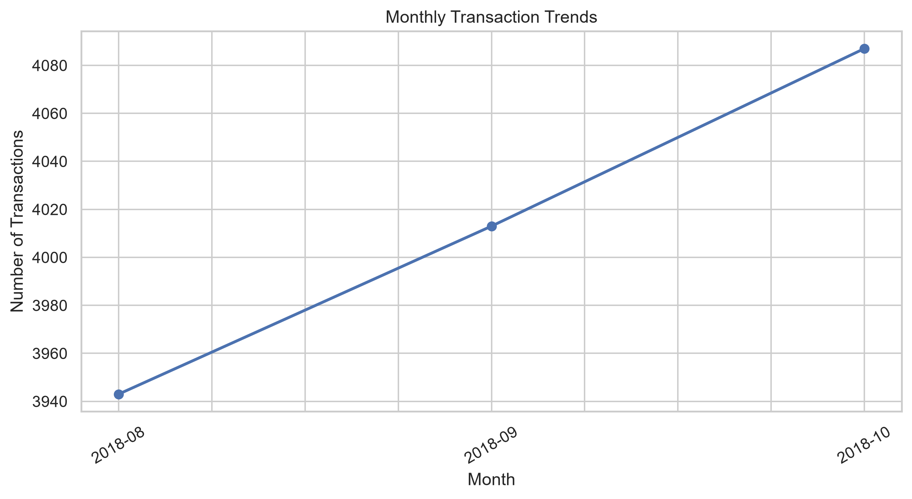

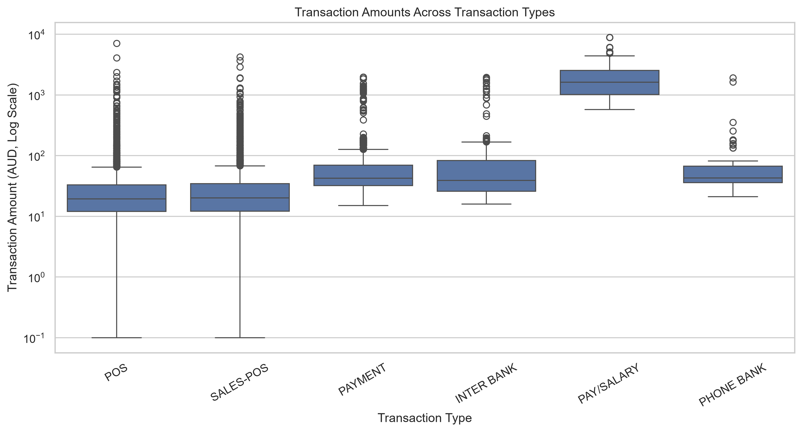

### Customer Behaviour Analysis

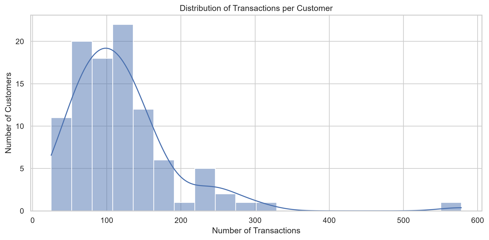

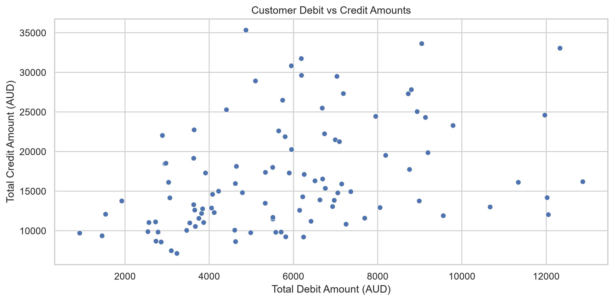

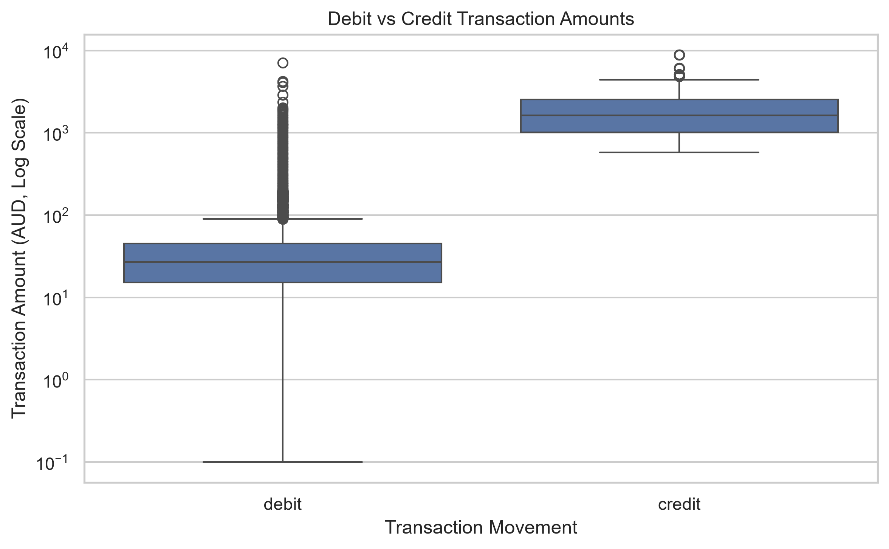

### Demographic Analysis

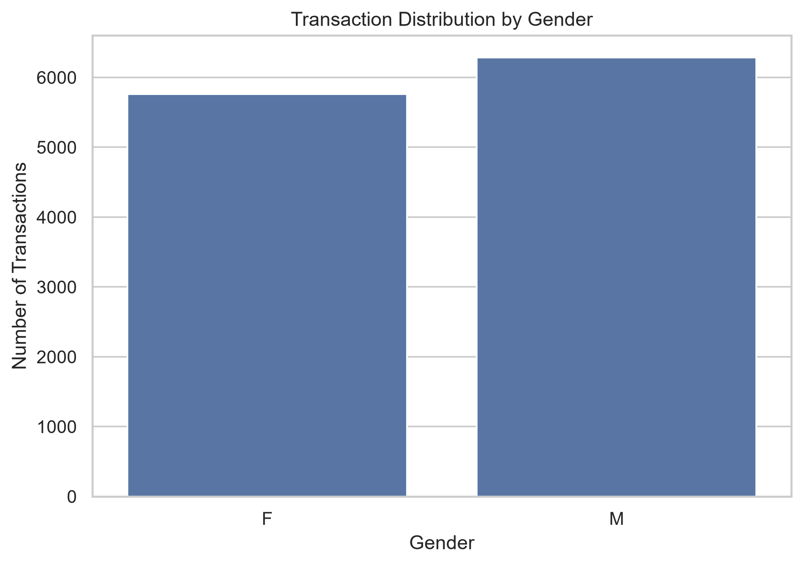

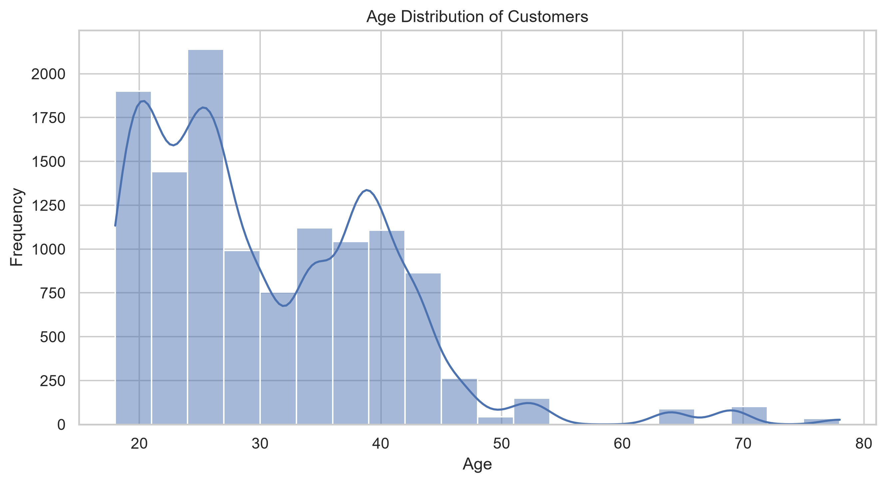

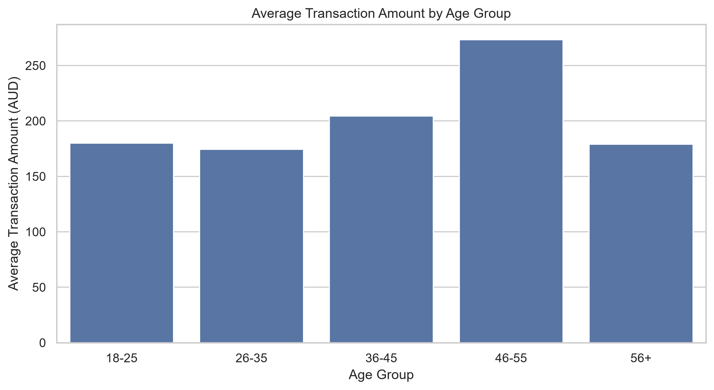

### Daily Trends and Account Analysis

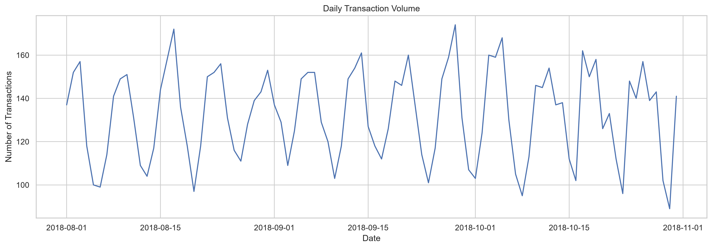

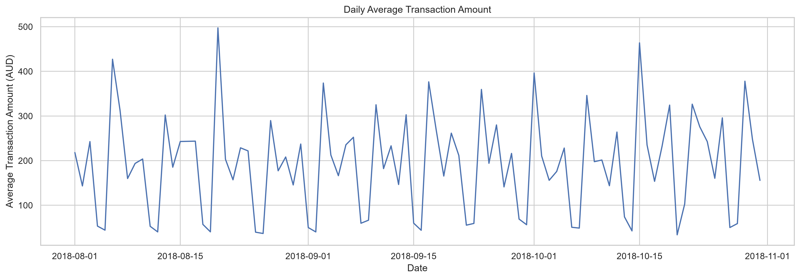

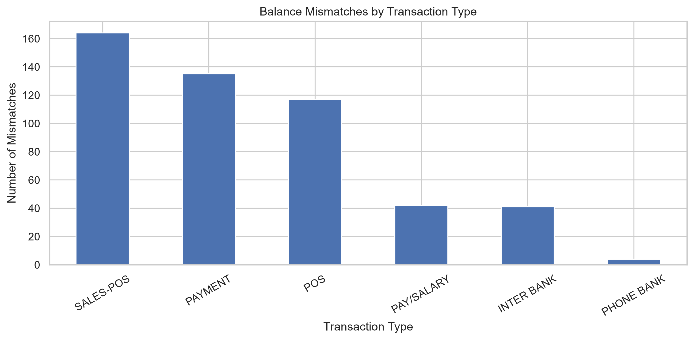

### Statistical Analysis

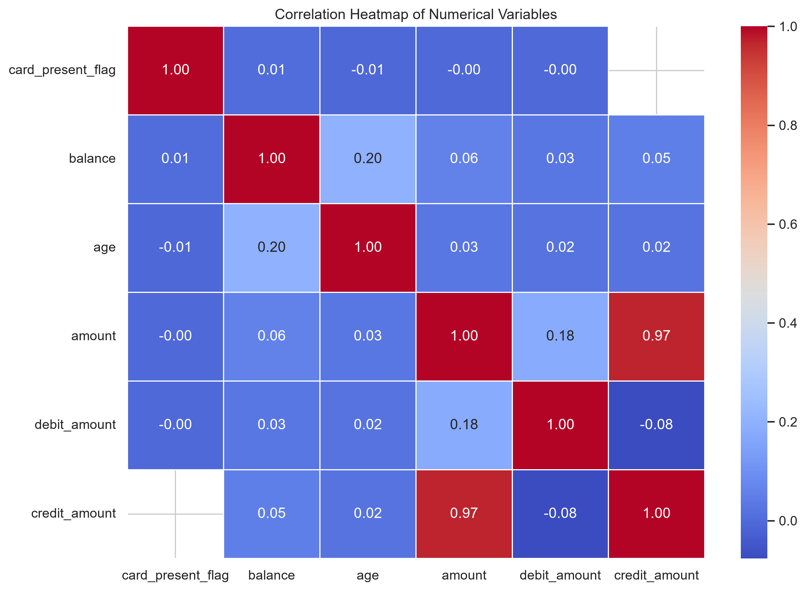

## Project Structure

```text
customer-transaction-analytics//
│
├── data/
│   ├── raw/                  # Original dataset (not uploaded)
│   └── processed/            # Cleaned dataset (not uploaded)
│
├── notebooks/
│   ├── 1_DataCollection_Cleaning.ipynb
│   ├── 2.EDA.ipynb
│   ├── 3.TransactionClassification.ipynb
│   ├── 4.Text_Analysis.ipynb
│   └── 5.Visualization_&_Dashboard.ipynb
│
├── src/                      # Supporting Python modules
│
├── dashboard/                # Interactive dashboard
│
├── images/                   # EDA visualisations
│
├── requirements.txt
├── requirements-lock.txt
├── .gitignore
└── README.md
```

## Installation and Setup

### 1. Clone the repository

```bash
git clone <YOUR_GITHUB_REPOSITORY_URL>
```

### 2. Navigate to the project directory

```bash
cd customer-transaction-analytics
```

### 3. Create a virtual environment

```bash
python -m venv venv
```

### 4. Activate the virtual environment

For Windows PowerShell:

```powershell
.\venv\Scripts\Activate.ps1
```

### 5. Install dependencies

```bash
python -m pip install -r requirements.txt
```

### 6. Add the dataset

Place the required dataset inside:

```text
data/raw/payment_transactions.csv
```

The dataset is not distributed with this repository.

### 7. Run the notebooks

Open the project in VS Code or Jupyter Notebook and execute the notebooks in sequence.

## Current Project Status

| Component | Status |
|---|---|
| Project setup and environment | Completed |
| Data collection and cleaning | Completed |
| Exploratory Data Analysis | Completed |
| EDA visualisations | Completed |
| Transaction classification | Pending |
| Text analysis | Pending |
| Interactive dashboard | Pending |
| Advanced anomaly detection | Planned |

## Future Scope

- Develop suitable predictive models for transaction analysis.
- Explore statistical and machine learning-based anomaly detection.
- Improve feature engineering and model evaluation.
- Develop an interactive dashboard using Streamlit and Plotly.
- Extend customer behaviour analysis.
- Improve the presentation and documentation of analytical findings.

---

**Project Note:** This project is being developed as a practical application of Python, data analysis, visualisation, and machine learning concepts. Its scope and implementation will evolve as development progresses.